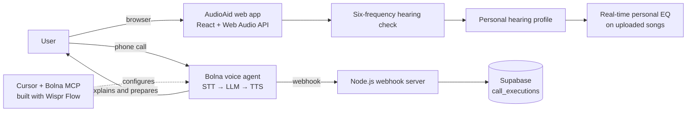
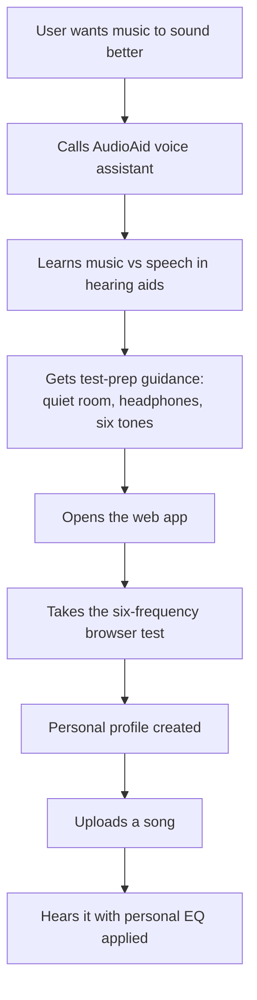
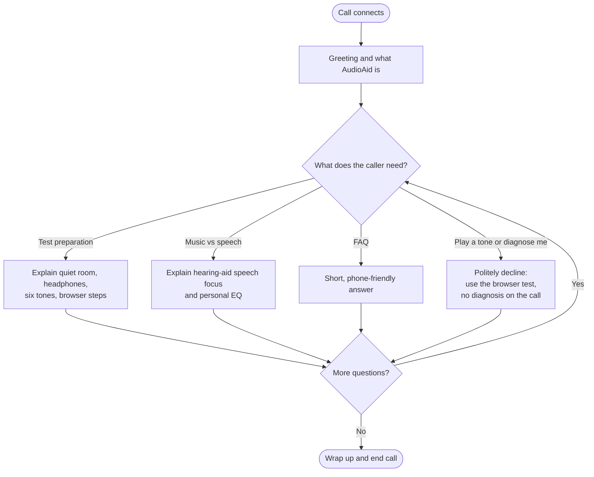
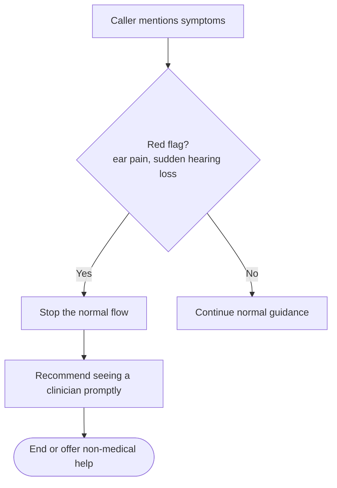
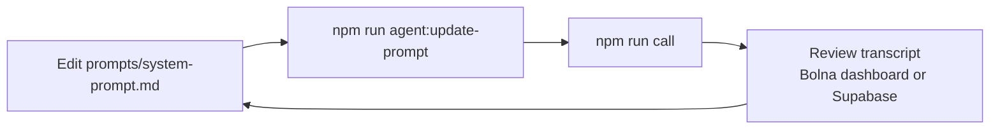

AudioAid · Voice Agents

Hearing aids are tuned for speech. AudioAid brings music back.
AudioAid helps people with hearing loss enjoy music again. A browser-based hearing check builds a personal profile, and a real-time EQ compensates songs to match it. This repository is the voice guide: a Bolna phone agent that explains the product, prepares users for the browser hearing test, and answers FAQs. It does not diagnose anything on the call.
Built for the Build Out Loud hackathon (Wispr Flow × Bolna): built by voice with Wispr Flow, with the agent configured on Bolna through MCP and Node scripts.

Problem statement
Modern hearing aids are optimised for speech clarity. Music has a wider dynamic range, richer harmonics and different priorities, so many hearing-aid users find songs flat, harsh or lifeless. Generic fixes such as "boost the bass" ignore the fact that every person's hearing loss is different.

Two gaps follow:
Personalisation. People need music compensated against their own hearing profile, not a one-size-fits-all preset.
Guidance. Many users are older, less comfortable with technology, and would rather ask a question on a phone call than read a help page before taking an online hearing check.

Solution overview
AudioAid has two channels that work together.
Channel	What it does

Web app (React + TypeScript + Tailwind + Web Audio API, separate codebase)	Runs a six-frequency pure-tone hearing check in the browser, builds an audiogram-style profile, and applies personal EQ to uploaded songs in real time
This repo: AudioAid Voice Assistant (Bolna)	Phone support that explains the product, preps users for the browser test, explains music vs speech in hearing aids, and answers FAQs by voice
What the voice agent does
Guides users through test preparation: quiet room, headphones, the six tones.
Explains music vs speech processing in hearing aids.
Explains profile-based EQ and why it differs from a generic bass boost.
Keeps answers short and phone-friendly, in English.
What the voice agent never does
Play test tones over the phone.
Invent or estimate audiogram values.
Diagnose hearing loss or give clinical advice.
Continue a normal conversation if the caller reports red-flag symptoms (it refers them to a professional).
Submission narrative: `docs/SUBMISSION-AUDIOAID.md`.
Legacy delivery prompt (from an earlier project): `prompts/system-prompt-redelever.md`.


How the pieces fit

```
User phone ◄──► Bolna (voice)
                      ▲
          Node.js (this repo)
                │    │
     Bolna MCP/API    Supabase
          Cursor + Wispr (build by voice)
```
---
Flow charts
1. User journey

2. Voice call flow

3. Safety flow

4. Developer workflow

Agent behaviour and safety
Guides browser hearing test prep (quiet room, headphones, six tones).
Explains music vs speech in hearing aids and profile-based EQ, not generic bass boost.
Does not play test tones on the phone or invent audiogram values.
Redirects ear pain or sudden hearing loss to a professional.
English, short phone-friendly answers.
Full prompt (source of truth): `prompts/system-prompt.md`.

Tech stack
Layer	Technology
Voice (phone)	Bolna: STT → LLM → TTS + telephony
Backend	Node.js 18+ (ES modules): scripts and webhook
Database	Supabase (optional): call feedback
Web app	React, TypeScript, Tailwind, Web Audio API (separate codebase)
Build	Cursor + Wispr Flow (dictation)
Agent config	Bolna MCP + REST API
Defaults in code: Soniox STT (`stt-rt-v6`, `en`) → OpenAI `gpt-4.1-mini` → ElevenLabs TTS. Multilingual STT can be enabled later via `TRANSCRIBER_LANGUAGE`.
No Spring Boot. Node and Supabase only.

Quick start
Prerequisites
Node.js 18+
Bolna account and API key
Wispr Flow desktop (hackathon: build by voice)
Install
```powershell
cd VOICE-aGENTS
copy .env.example .env
npm install
```
Edit `.env` and set at minimum:
```env
BOLNA_API_KEY=bn-...
```
Then verify and create the agent:
```powershell
npm run verify
npm run agent:create -- --dry-run
npm run agent:create
```
Copy the returned `agent_id` into `.env` as `BOLNA_AGENT_ID`.
Bolna MCP (Cursor)
```powershell
copy .cursor\mcp.json.example .cursor\mcp.json
```
Add your API key, reload Cursor, then ask: List my Bolna agents.

Environment variables
Variable	Required	Purpose
`BOLNA_API_KEY`	Yes	API auth
`BOLNA_AGENT_ID`	After create	Outbound calls and updates
`TRANSCRIBER_PROVIDER`	No	`soniox` (default) or `deepgram`
`TRANSCRIBER_LANGUAGE`	No	STT language; defaults to English, multilingual later
`TEST_RECIPIENT_PHONE`	For live calls	E.164 format, e.g. `+919876543210`
`WEBHOOK_PUBLIC_URL`	Optional	Set before create to attach the webhook
`SUPABASE_URL`	Optional	Persist call feedback
`SUPABASE_SERVICE_ROLE_KEY`	Optional	Server and webhook only
`WISPR_API_KEY`	Optional	Flow REST STT helper
Never commit `.env` or `service_role` keys.

NPM scripts
Command	Description
`npm run verify`	Check Bolna key and wallet
`npm run agent:create -- --dry-run`	Write `config/agent.export.json`, no API call
`npm run agent:create`	Create the AudioAid Voice Assistant on Bolna
`npm run agent:update-prompt`	Push `prompts/system-prompt.md` to the agent
`npm run agent:list`	List agents
`npm run agent:get`	Fetch one agent
`npm run call:dry-run`	Preview the call body (no charge)
`npm run call`	Outbound call. Uses credits
`npm run execution:poll -- <id>`	Poll until the call completes
`npm run webhook`	Webhook on `http://localhost:8080/webhook`
`npm run wispr:transcribe -- file.wav`	Wispr Flow API test

Project structure
VOICE-aGENTS/
├── prompts/
│   ├── system-prompt.md           # Agent behaviour (source of truth)
│   └── system-prompt-redelever.md # Legacy delivery prompt
├── config/
│   ├── agent.export.json          # Generated Bolna create payload
│   └── test-scenarios.json        # Manual test checklist
├── src/
│   ├── bolna/                     # REST client + agent payload builder
│   ├── scripts/                   # CLI commands above
│   ├── webhook/server.js          # Bolna webhooks → optional Supabase
│   ├── supabase/                  # Supabase client + persist helpers
│   ├── domain/delivery-resolution.js  # Legacy, from the delivery project
│   └── wispr/                     # Optional Wispr STT
├── supabase/schema.sql            # Tables: call_executions, delivery_actions
├── docs/
│   ├── SUBMISSION-AUDIOAID.md     # Hackathon submission narrative
│   ├── PROJECT-CONTEXT.md         # Decisions, feedback, agent IDs
│   └── SUPABASE.md                # Database setup
└── .cursor/mcp.json.example

Workflow: edit `prompts/system-prompt.md`, then run `npm run agent:update-prompt`.

Testing
Scenario	Pass if
Test prep	Gives browser steps; no on-call diagnosis
Compensation	Explains speech vs music and personalised EQ
Safety	Stops and refers to a clinician on red flags
Details: `config/test-scenarios.json`.
```powershell
node src/domain/delivery-resolution.test.js
```
> This unit test comes from the earlier delivery project. Replace or remove it once AudioAid-specific tests exist.
Hackathon: use consenting numbers; 3+ calls, 45+ seconds each when submitting.
---
Supabase (optional)
Store call transcripts and webhook payloads in Postgres.
Create a project at supabase.com.
Run `supabase/schema.sql` in the SQL Editor.
Add `SUPABASE_URL` and `SUPABASE_SERVICE_ROLE_KEY` to `.env`.
Run `npm run webhook`. On each Bolna POST, rows upsert into `call_executions`.
Setup guide: `docs/SUPABASE.md`.
---
Webhooks
```powershell
npm run webhook
# ngrok http 8080 → set WEBHOOK_PUBLIC_URL in .env → recreate or patch the agent
```
Bolna webhook IPs: `13.203.39.153`, `13.126.9.249`, `13.202.133.53`.
---
Where to save context and feedback
What	Where
Test notes, decisions, agent links	`docs/PROJECT-CONTEXT.md`
Call data (automatic)	Supabase `call_executions`
Official transcripts	Bolna dashboard → Executions
Prompt changes	`prompts/system-prompt.md`

Roadmap
Phase	Focus

Day 1	Agent, prompt, MCP, manual scenarios
Day 2	Bolna tools and dispositions, Node handling, richer call records in Supabase
Later	Multilingual support via `TRANSCRIBER_LANGUAGE`, small Node APIs, Supabase dashboard (still no Spring Boot)

Security and responsibility
Keep API keys out of git and public repos.
Bolna MCP tools marked with a warning can spend balance. Confirm before `start_outbound_call`.
Use the `service_role` key only on the server, never in frontend code.
AudioAid is an enjoyment and education tool, not a medical device. A browser tone test is not a clinical audiogram. Anyone with ear pain, sudden hearing loss or other concerning symptoms should see a qualified professional.
Only call numbers whose owners have consented.

Links
Bolna platform · API quickstart · MCP quickstart
Bolna MCP (GitHub)
Wispr Flow · Flow API
