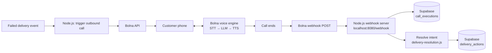
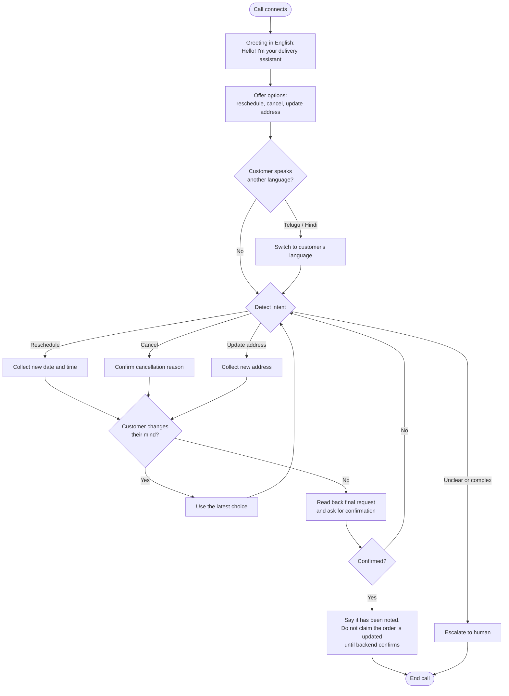
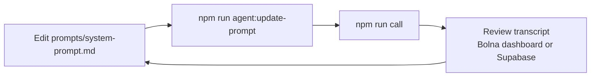

Voice Agents

Multilingual failed delivery recovery voice agent for the Build Out Loud hackathon (Wispr Flow × Bolna).
ReDeliver Assistant calls customers after a failed delivery, understands whether they want to reschedule, cancel, or update their address, and confirms before any backend update.

Description Of The problem Statement

When a delivery fails, the customer is usually left with a generic SMS or a support queue. Delivery companies lose time and money on repeat attempts, returns-to-origin and manual call-center follow-ups, while customers wait with no easy way to say what they actually want.

What ReDeliver Assistant does
ReDeliver Assistant is an AI voice agent that proactively phones the customer right after a failed delivery attempt and resolves it in one conversation:
Understands intent in natural speech: reschedule, cancel, or update address.
Speaks the customer's language: starts in English and follows the customer into Telugu or Hindi if they switch.
Handles interruptions: if the customer changes their mind mid-call (for example "10 AM... actually make it 6 PM"), the agent uses the latest choice.
Confirms before acting: it repeats the final request back and asks for a yes before anything is written to the backend.
Stays honest: it never invents order status and never claims an update happened without backend confirmation.
Escalates complex cases to a human.
Who it is for
Logistics and e-commerce teams that want to recover failed deliveries automatically, and customers who would rather talk for 45 seconds than navigate an app.

Solution approach :

The solution is split into three layers so each piece can be built, tested and replaced independently.
Layer	Responsibility	Implemented with
1. Conversation	Listen, understand, respond, handle language switches and interruptions	Bolna (STT → LLM → TTS + telephony), driven by `prompts/system-prompt.md`
2. Orchestration	Create/update agents, trigger outbound calls, receive call results	Node.js scripts + webhook server, Bolna REST API and MCP
3. Persistence	Store call transcripts, outcomes and the delivery action requested	Supabase (Postgres): `call_executions`, `delivery_actions`
Design decisions
Prompt as the source of truth. The agent's behaviour lives in one file (`prompts/system-prompt.md`). Edit it, run `npm run agent:update-prompt`, and the live agent changes. No redeploy needed.
Confirm-then-commit. The agent never treats a spoken request as final. It must read back the latest choice and receive a confirmation, which keeps the agent safe when customers change their mind or speech is misrecognised.
Latest intent wins. Interruptions and corrections are expected. The prompt tells the agent to follow the most recent instruction rather than the first one.
Multilingual from the first turn. A multilingual STT model (Soniox `stt-rt-v6` by default, Deepgram as an alternative) lets the agent follow the customer between English, Telugu and Hindi without restarting the call.
Lean backend. Node.js and Supabase only. No heavy framework is needed for a webhook and a few scripts, which keeps the hackathon build fast.
Optional persistence. The voice agent works without Supabase. Add it when you want transcripts and delivery actions stored.
Agent configuration is code. `agent:create` generates `config/agent.export.json`, and `--dry-run` lets you inspect payloads before spending credits.

Step-by-step approach

Define behaviour: write the system prompt (intents, languages, confirmation rules, escalation).
Create the agent: `npm run agent:create` provisions ReDeliver Assistant on Bolna with STT, LLM and TTS defaults.
Test manually: run the scenarios in `config/test-scenarios.json` (time change, language switch).
Place calls: `npm run call` triggers an outbound call to a consenting test number.
Capture results: Bolna posts call data to the webhook, which upserts rows into Supabase.
Iterate: review transcripts, tweak the prompt, push with `agent:update-prompt`, repeat.
Close the loop (Day 2): map Bolna tools/dispositions to Node, which writes confirmed `delivery_actions`.
---
Flow charts
1. End-to-end system flow

2. Conversation flow

3. Developer workflow

---
Tech stack
Layer	Technology
Voice (phone)	Bolna — STT → LLM → TTS + telephony
Backend	Node.js 18+ (ES modules) — scripts, webhook
Database	Supabase (Postgres) — call feedback & delivery records
Build	Cursor + Wispr Flow (dictation)
Agent config	Bolna MCP + REST API
Defaults in code: Soniox STT (`stt-rt-v6`, multilingual) → OpenAI `gpt-4.1-mini` → ElevenLabs TTS.
No Spring Boot — Node and Supabase only.
```
Customer phone ◄──► Bolna (voice)
                         ▲
              Node.js (this repo)
                    │    │
         Bolna MCP/API    Supabase
              Cursor + Wispr (build by voice)
```
---
Quick start
Prerequisites
Node.js 18+
Bolna account + API key
Wispr Flow desktop (hackathon: build by voice)
Install
```powershell
cd VOICE-aGENTS
copy .env.example .env
npm install
```
Edit `.env` — set at minimum:
```env
BOLNA_API_KEY=bn-...
```
```powershell
npm run verify
npm run agent:create -- --dry-run
npm run agent:create
```
Copy the returned `agent_id` into `.env` as `BOLNA_AGENT_ID`.
Bolna MCP (Cursor)
```powershell
copy .cursor\mcp.json.example .cursor\mcp.json
```
Add your API key, reload Cursor, then ask: List my Bolna agents.
---
Environment variables
Variable	Required	Purpose
`BOLNA_API_KEY`	Yes	API auth
`BOLNA_AGENT_ID`	After create	Outbound calls & updates
`TRANSCRIBER_PROVIDER`	No	`soniox` (default) or `deepgram`
`TEST_RECIPIENT_PHONE`	For live calls	E.164, e.g. `+919876543210`
`WEBHOOK_PUBLIC_URL`	Optional	Set before create to attach webhook
`SUPABASE_URL`	Optional	Persist call feedback
`SUPABASE_SERVICE_ROLE_KEY`	Optional	Server/webhook only
`WISPR_API_KEY`	Optional	Flow REST STT helper
Never commit `.env` or `service_role` keys.
---
NPM scripts
Command	Description
`npm run verify`	Check Bolna key and wallet
`npm run agent:create -- --dry-run`	Write `config/agent.export.json`, no API call
`npm run agent:create`	Create ReDeliver Assistant on Bolna
`npm run agent:update-prompt`	Push `prompts/system-prompt.md` to agent
`npm run agent:list`	List agents
`npm run agent:get`	Fetch one agent
`npm run call:dry-run`	Preview call body (no charge)
`npm run call`	Outbound call — uses credits
`npm run execution:poll -- <id>`	Poll until call completes
`npm run webhook`	Webhook on `http://localhost:8080/webhook`
`npm run wispr:transcribe -- file.wav`	Wispr Flow API test
---
Project structure
```
VOICE-aGENTS/
├── prompts/system-prompt.md       # Agent behaviour (source of truth)
├── config/
│   ├── agent.export.json          # Generated Bolna create payload
│   └── test-scenarios.json        # Manual test checklist
├── src/
│   ├── bolna/                     # REST client + agent payload builder
│   ├── scripts/                   # CLI commands above
│   ├── webhook/server.js          # Bolna webhooks → optional Supabase
│   ├── supabase/                  # Supabase client + persist helpers
│   ├── domain/delivery-resolution.js
│   └── wispr/                     # Optional Wispr STT
├── supabase/schema.sql            # Tables: call_executions, delivery_actions
├── docs/
│   ├── PROJECT-CONTEXT.md         # Decisions, feedback, agent IDs
│   └── SUPABASE.md                # Database setup
└── .cursor/mcp.json.example
```
Workflow: edit `prompts/system-prompt.md` → `npm run agent:update-prompt`.
---
Agent behaviour
Greeting: Hello! I'm your delivery assistant.
Start in English; follow Telugu or Hindi if the customer switches.
Offer reschedule, cancel, or address update.
After interruptions, use the latest customer choice and ask for confirmation.
Never invent order status or claim an update without backend confirmation.
Escalate complex cases to a human.
Full prompt: `prompts/system-prompt.md`.
---
Testing
Scenario	Pass if
Time change (10 AM → 6 PM)	Confirms 6 PM; does not say order was updated
Language switch	Follows Telugu/Hindi; confirms final preference
Details: `config/test-scenarios.json`.
```powershell
node src/domain/delivery-resolution.test.js
```
Hackathon: use consenting numbers; 3+ calls, 45+ seconds each when submitting.
---
Supabase (optional)
Store call transcripts and webhook payloads in Postgres.
Create a project at supabase.com.
Run `supabase/schema.sql` in the SQL Editor.
Add `SUPABASE_URL` and `SUPABASE_SERVICE_ROLE_KEY` to `.env`.
`npm run webhook` — on each Bolna POST, rows upsert into `call_executions`.
Setup guide: `docs/SUPABASE.md`.
---
Webhooks
```powershell
npm run webhook
# ngrok http 8080 → set WEBHOOK_PUBLIC_URL in .env → recreate or patch agent
```
Bolna webhook IPs: `13.203.39.153`, `13.126.9.249`, `13.202.133.53`.
---
Where to save context & feedback
What	Where
Test notes, decisions, agent links	`docs/PROJECT-CONTEXT.md`
Call data (automatic)	Supabase `call_executions`
Official transcripts	Bolna dashboard → Executions
Prompt changes	`prompts/system-prompt.md`
---
Roadmap
Phase	Focus
Day 1	Agent, prompt, MCP, manual scenarios
Day 2	Bolna tools/dispositions → Node → `delivery_actions` in Supabase
Later	Small Node APIs + Supabase dashboard (still no Spring Boot)
---
Security
Keep API keys out of git and public repos.
Bolna MCP ⚠ tools can spend balance — confirm before `start_outbound_call`.
Use service_role only on the server, never in frontend code.
---
Links
Bolna platform · API quickstart · MCP quickstart
Bolna MCP (GitHub)
Wispr Flow · Flow API
